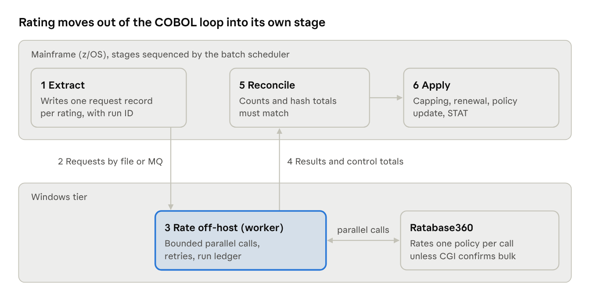
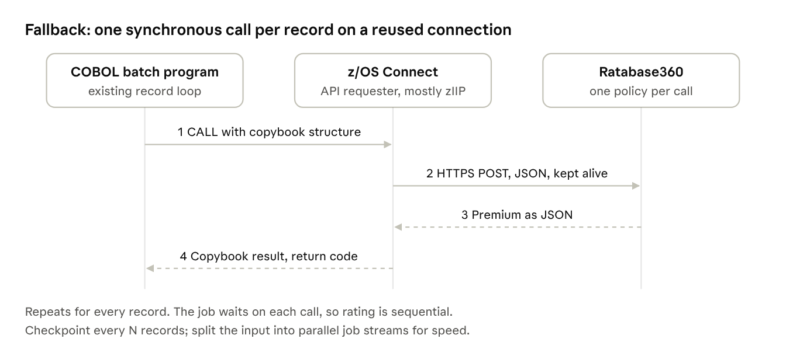
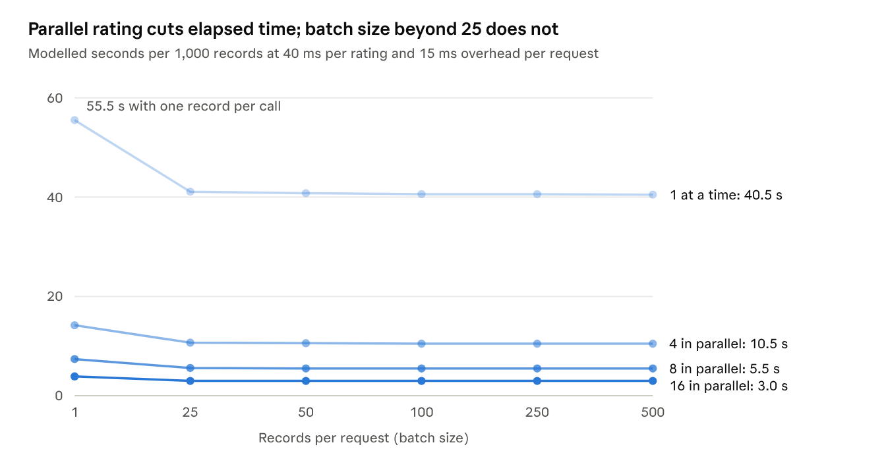

# Ratabase360 batch rating integration: architecture recommendation

As of November 24, 2026

## Summary to share

**Recommendation.** Do not choose between bulk REST and MQ yet. For scheduled batch, take rating out of the COBOL record loop: the mainframe writes a rating-request file, a small Windows worker rates it against Ratabase360 in parallel, and the mainframe reads the results and continues with capping, renewals and STAT. Move the work between platforms on what we already run, MQ or managed file transfer.

**Why not simply "bulk REST".** CGI's public material describes Ratabase360 as a real-time, per-transaction rating API. No production bulk-rating endpoint is documented publicly. Unless CGI confirms one, a bulk REST call means building our own adapter that still rates one policy at a time behind it.

**What batching does and does not do.** Batching removes per-call communication overhead. It does not make the engine rate faster. In an illustrative model, batches of 100 cut elapsed time by about 27%, while rating 8 policies at once cuts it by about 87%. Batch sizes above about 25 change almost nothing.

**It may not be a problem at today's volume.** At 5,000 records, one call per record on a reused connection models at under 5 minutes. We should measure before building anything.

**Fallback.** If rating cannot leave the loop, for example rate, cap, then re-rate logic, keep one synchronous call per record through z/OS Connect or MQ request/reply and gain speed from parallel job streams.

**Next step.** Put four questions to CGI, then run a two-week benchmark that measures per-record rating time, per-call overhead and the engine's concurrency limit. Every timing in this document is a model until that benchmark runs.

## Executive summary

The recommendation is conditional on two facts we do not have yet: whether rating can be separated from the per-record loop, and what Ratabase360 offers for batch.

| If | Then |
| --- | --- |
| Rating inputs are known before the loop runs (expected for renewals and daily batch) | **Staged batch**: extract requests, rate off-host in parallel, apply results. Recommended default. |
| Rating must stay inside the loop (rate, cap, re-rate, or later records depend on earlier premiums) | **Synchronous call per record** from COBOL, through z/OS Connect API requester if licensed, otherwise MQ request/reply. Parallel job streams for speed. |
| CGI confirms a supported production batch interface | Use it in place of our Windows worker. The staged flow on the mainframe does not change. |
| The rating is interactive (quote, endorsement, online inquiry) | Direct synchronous API call per transaction. Do not route it through batch plumbing. |

Four reasons carry the recommendation.

- **The engine, not the network, sets the floor.** Elapsed time is roughly records × rating time ÷ parallelism. Batching only trims the smaller overhead term.
- **COBOL batch is good at files and poor at concurrency.** A staged design lets the mainframe do sequential I/O and lets a Windows service do the parallel HTTP work it is suited to.
- **A remote call inside the loop ties the batch window to the network and to a vendor service.** Staging turns an outage into a delayed step that restarts cleanly, not an abend mid-file.
- **It is the least new infrastructure.** One small worker service plus a scheduler, and a transport the company already operates. No new orchestration platform.

The model in this document assumes 40 ms per rating and 15 ms per-call overhead. Both are placeholders. If measured rating time is far lower, batching matters more; if far higher, only parallelism matters.

## What is verified and what is assumed

No public source documents a Ratabase360 production bulk-rating endpoint, so this design does not depend on one. CGI publishes marketing material only; its API documentation is not public, so every Ratabase360 integration detail below needs CGI's confirmation.

### Verified from sources opened for this review

| Fact | Source |
| --- | --- |
| Ratabase360 is sold as a SaaS, cloud-based product that integrates with policy administration systems through APIs | [CGI Ratabase360 brochure](https://www.cgi.com/sites/default/files/2023-11/cgi_ratabase360.pdf) |
| It rates individual policy transactions in real time with sub-second response. No batch or bulk mode is described | [CGI Ratabase360 product page](https://www.cgi.com/en/solutions/ratabase360-insurance-rating-software) |
| "Batch rerating" appears only under Ratabase Actuarial, for simulation runs over a book of business, not for production policy processing | [CGI Ratabase Actuarial](https://www.cgi.com/en/solutions/ratabase/ratabase-actuarial) |
| Classic Ratabase, as profiled in 2019, ran on z/OS batch, CICS and Windows, offered web service, MQ and JMS integration with COBOL adapters, and used a stateless, load-balanced rating service | [2019 analyst vendor profile](https://compete-cms.aws.dev.progressivedigitalmedia.com/Uploads/Report/274819/341865340_c7f54e21d5.pdf) |
| COBOL batch programs can call REST APIs through z/OS Connect API requester. The batch stub keeps a persistent connection to the z/OS Connect server and defaults to a 10-second response timeout | [IBM: configuring other z/OS applications for API calls](https://www.ibm.com/support/knowledgecenter/en/SS4SVW_3.0.0/configuring/config_batch_commstub.html) |
| z/OS Connect is Java and up to 99% zIIP-eligible. MQ, CICS and Db2 run mainly on general-purpose processors | [IBM: GCPs and zIIPs](https://www.ibm.com/docs/en/SS4SVW_3.0.0/performance/GCPs_zIIPs.html) |
| IBM lab benchmark, 2018: API requester cost 0.37 to 0.67 ms CPU per request for 1 KB to 8 KB responses. Security was disabled and the caller was CICS, not batch | [IBM API requester performance report](https://public.dhe.ibm.com/software/htp/cics/support/supportpacs/individual/zOS-Connect-EE-v30-Performance-ApiRequester-v1.0.pdf) |
| The z/OS client web enablement toolkit gives COBOL batch a native HTTP/HTTPS client and JSON parser with no extra server | [IBM: z/OS client web enablement toolkit](https://www.ibm.com/docs/SSLTBW_2.3.0/com.ibm.zos.v2r3.ieac100/ieac1-client-web-enablement.htm) |
| MQ for z/OS: persistent messages are logged, log speed limits throughput, and about 100 short messages per syncpoint is the usual guidance | [IBM MQ: design and performance considerations](https://www.ibm.com/support/knowledgecenter/en/SSFKSJ_8.0.0/com.ibm.mq.dev.doc/q023870_.htm) |

### Not verified: confirm before committing

| Open point | Why it matters |
| --- | --- |
| Whether our Ratabase360 is CGI-hosted SaaS or a Windows-hosted deployment. Our working assumption says Windows server; CGI's material says SaaS | Decides network path, latency, who owns scaling, and where a worker can run |
| Whether one API call can carry several policies, and whether the engine rates them in parallel | Separates true bulk rating from an adapter that loops |
| Whether Ratabase360 kept classic Ratabase's batch and MQ interfaces | A supported batch interface would remove the need for our own worker |
| Protocol and payload: REST/JSON or SOAP/XML, typical request and response size | Drives serialization cost and message-size limits |
| Concurrency limits or throttling per tenant | Caps the parallelism that all performance gains depend on |
| How a rate or product version is pinned for a run | Needed for consistent premiums across retries and restarts |
| Per-record rating time for our products | The largest term in every estimate here |
| Our own estate: z/OS Connect licence, MQ on z/OS and Windows, managed file transfer product, scheduler | Decides which transport is "existing technology" for us |

## Challenging the assumptions

The starting premise, that per-record calls cost too much and groups of 100 fix it, is only partly right. Five assumptions deserve a second look.

**1. "Per-call overhead is too high."** Probably overstated. The expensive parts of an HTTPS call are the TCP connection and TLS handshake. On a reused connection they are paid once per job, not once per record. IBM's own guidance is that [persistent connections spread the handshake cost over many requests](https://www.ibm.com/support/knowledgecenter/en/SS4SVW_3.0.0/securing/provider_confidentiality_integrity.html). What remains per call is a network round trip and message handling: milliseconds inside a data centre, more to a remote cloud.

**2. "Batching 100 records makes it 100 times faster."** The Copilot arithmetic, 16.7 minutes down to 10 seconds, assumes a 100-record request takes as long as a one-record request. It does not: the engine still rates 100 policies. Batching removes overhead only. If rating is 40 ms and overhead is 15 ms, the best possible gain from batching alone is 27%.

**3. "Modify the replacement service to accept an array."** The replacement is a vendor product. We cannot change its interface. A bulk endpoint is either something CGI already supports or something we build and run in front of it.

**4. "100 is a sensible size."** It is arbitrary. CGI describes thousands of data items per rating transaction, so 100 requests in one payload may run to megabytes. Larger batches mean longer timeouts, coarser retries and harder partial-failure handling, for almost no extra speed.

**5. "Rating has to stay where the subprogram call is."** This is the assumption most worth breaking. A local CALL takes microseconds and never fails for network reasons. A remote call in the same place makes every record depend on the network, a Windows tier and possibly a vendor cloud. Moving rating to its own stage removes that coupling.

### When rating can leave the loop

Rating can become its own stage if the answers below are all "no". This needs a code review of the batch programs, not an assumption.

- Does any record's rating input depend on a premium rated earlier in the same run, such as account-level or multi-policy discounts computed on the fly?
- Does the program re-rate after capping, or iterate until a premium converges?
- Does the program update the database before the rating call in a way that must commit or roll back together with the result?

Capping, renewal offers and statistical processing consume the rated premium, so they sit downstream and move to the apply stage unchanged. A program that rates the same policy several times, for example new-business and renewal premiums for a cap comparison, still qualifies: it emits several requests per policy.

### Alternatives outside the original two

- **Parallel job streams.** Split the input by key range into several jobs that each call synchronously. This is the standard mainframe route to concurrency and needs no asynchronous code.
- **A vendor batch interface.** Classic Ratabase supported z/OS batch and MQ. If today's subprogram is mainframe Ratabase, ask CGI what the supported batch path is for Ratabase360 customers.
- **Keep batch rating on the mainframe and move only online rating.** Lowest change, but two engines must produce identical premiums from synchronised rate versions. Treat it as a transition state, not a target.

## Options evaluated

Eight options reduce to two real choices: where the rating call sits (inside the loop or in its own stage) and what carries the data (HTTP, MQ or files). Every option except a direct single-record call needs a component on the distributed side that calls Ratabase360.

### A. Synchronous REST from COBOL

The program calls out and waits. Two supported mechanisms exist.

- **z/OS Connect API requester.** Tooling generates copybooks from the API's OpenAPI document. z/OS Connect does the JSON conversion, TLS and token handling on zIIP-eligible Java. It needs a z/OS Connect licence, a started task, and a JSON API described by OpenAPI. Arrays map to fixed-maximum copybook tables, so large bulk payloads make large structures.
- **z/OS client web enablement toolkit.** Part of the operating system, no extra server. The COBOL program builds and parses JSON and manages the connection itself, on general-purpose CPU.

One request is in flight per job, so rating is sequential. A "bulk" request helps only if something on the far side accepts it. Verdict: the right choice when rating must stay in the loop, starting with single-record calls.

### B. MQ synchronous request/reply

The program puts a request, then waits on a reply queue by correlation ID. Ratabase360 does not read queues as far as public material shows, so a Windows consumer must still call it. Each request must be committed before the consumer can see it, which means log I/O per record for persistent messages. It is still sequential. Verdict: equivalent to option A with an extra hop. Choose it only if MQ is the approved route off the mainframe or z/OS Connect is unavailable.

### C. MQ asynchronous, many requests in flight

The program puts all requests, committing about every 100. A pool of consumers rates them in parallel and puts replies. Replies arrive out of order and are matched by key. This delivers real parallelism with built-in persistence and backpressure through queue depth. Doing this inside one COBOL program forces a put phase and a get phase, which is the staged design with queues as the carrier. Verdict: strong, and the preferred carrier where MQ already runs on both platforms.

### D. Windows worker or adapter service

A small service that takes requests from a queue, file or HTTP, calls Ratabase360 with pooled connections and bounded parallelism, retries, and returns results. It accepts work in bulk but invokes the engine one policy at a time. That is middleware batching, not native bulk rating, and its speed comes from parallel calls. Keep it thin: no rating logic, no business rules, and no data store beyond a run ledger. Verdict: required by options B, C, E and F unless CGI supplies the equivalent.

### E. Staged batch: extract, rate, apply

The existing program stops calling the rating subprogram and writes a request record instead. A second stage rates off-host. A third stage reads results matched to the original driver file and performs capping, renewal and policy updates. The scheduler sequences the stages. Verdict: recommended for scheduled work, subject to the dependency check above.

### F. File exchange with managed file transfer

The carrier for option E when files are preferred. Connect:Direct can copy a file and then run a task on the remote node, [waiting for it to finish](https://public.dhe.ibm.com/software/commerce/doc/mft/cdcommon/cdproc_overview.pdf) before continuing. Files give natural checkpoints and simple control totals. Convert packed-decimal fields to display format before any EBCDIC to ASCII transfer. Verdict: the simplest carrier and the easiest to operate and restart.

### G. Native Ratabase360 batch

Not verified. If CGI supports file-in, file-out or queue-based production rating, it replaces option D and keeps options E and F unchanged. Verdict: ask first; adopt if it exists and is supported for production policy processing.

### H. Hybrid

Scheduled batch uses the staged flow. Interactive rating calls the API directly per transaction. Both must reach the same Ratabase360 environment and rate version so that a quote and its renewal price identically. Verdict: this is the recommended overall shape.

## Decision matrix

Staged batch scores best on the criteria that matter most here: parallel rating, mainframe CPU and restart. Ratings are qualitative judgements, not measurements.

| Option | Parallel rating | Mainframe CPU | COBOL change | Restart and recovery | New components | Fits when |
| --- | --- | --- | --- | --- | --- | --- |
| Per-record sync REST, in loop | No, unless jobs are split | Low; JSON work is zIIP-eligible in z/OS Connect | Small: swap the CALL, add error handling | Weak: checkpoint plus idempotent re-call | z/OS Connect if not owned | Rating must stay in the loop; low thousands of records |
| Bulk sync REST through an adapter, in loop | Only inside the adapter | Lowest per record of the in-loop options | Medium: accumulate, call, redistribute | Weak: a timeout leaves a whole group in doubt | z/OS Connect and an adapter service | Measured overhead share is large |
| MQ sync request/reply, in loop | No | Higher; put, get and commit per record on general-purpose CPU | Medium: MQI calls and reply matching | Fair: requests survive an outage | Worker service, queues | MQ is the mandated route |
| MQ async, windowed in one program | Yes | Moderate | Large: put phase and get phase | Good: queues hold state | Worker service, queues | Rating cannot fully leave the program |
| **Staged batch over files** | **Yes** | **Lowest: sequential file I/O only** | Medium to large: split into extract and apply | **Best: rerun one stage; files are checkpoints** | Worker service, transfer process, scheduler jobs | **Scheduled batch: default** |
| Staged batch over MQ | Yes | Low to moderate | Medium to large, plus MQI | Very good | Worker service, queues | MQ runs on both platforms and record-level visibility is wanted |
| Native Ratabase360 batch | Unknown | Lowest | Same split as staged batch | Depends on CGI | None of ours | CGI confirms production support |

## Recommended architecture and flow

Scheduled batch becomes three stages with one hand-off in each direction; no policy is updated until every result is back and reconciled.



The mainframe never waits on a network call: it writes requests, and later reads results. Only the worker talks to Ratabase360.

### End-to-end flow

1. **Extract (mainframe).** The existing program builds each rating input as it does today, then writes a fixed-format request record where it used to call the subprogram. Each record carries a run ID, a sequence number, the policy key and the transaction type. A trailer holds the record count and a hash total.
2. **Hand-off.** The scheduler triggers a file transfer, or the extract step puts messages to MQ and commits about every 100. A header carries the run ID and the rate as-of date for the whole run.
3. **Rate (Windows worker).** The worker checks the header and trailer, builds a Ratabase360 request per record, and keeps a configured number of calls in flight over pooled, kept-alive connections. Each result or coded error goes into a run ledger keyed by run ID and sequence. A record already in the ledger is not rated again.
4. **Return.** The worker writes one result per request, in request order, with a trailer of counts rated and rejected and a premium hash total.
5. **Reconcile (mainframe).** A utility step confirms that the count sent equals the count returned, every sequence number appears once, and the run ID matches. Any mismatch stops the stream before a policy is touched.
6. **Apply (mainframe).** COBOL reads the driver file and the result file together, matched on sequence. It performs capping, renewal, policy update and STAT feeds as today, taking the premium from the result record. Rating rejects go to the existing error or suspense path.

### Design rules

| Concern | Rule |
| --- | --- |
| Correlation | Batch level: run ID built from job name, business date and run number. Record level: sequence number plus policy, term and transaction. With MQ, the same values go in the correlation ID. |
| Ordering | Parallel rating must never depend on order. Results are re-sequenced before the apply stage. |
| Idempotency | The ledger makes re-submission safe: the same run ID and sequence returns the stored result. Rating is read-only, so the apply stage is the only step that must run exactly once, under its existing checkpoint and restart. |
| Rate version consistency | Every request in a run carries the same as-of date or version identifier, and the worker stores the version each result came from. A restarted run reuses stored results and never mixes rate versions. How a version is pinned needs CGI's confirmation. |
| Precision and rounding | Amounts cross platforms as character decimals with explicit scale, never binary floating point. The worker uses decimal types. Rounding happens once, in the engine. The mainframe does not recompute a premium. |
| Timeouts and retries | A short per-call timeout. Retry timeouts, server errors and throttling with backoff, a fixed number of times. Never retry a business rejection. Pause the run if the error rate spikes. |
| Concurrency and backpressure | One configured cap on calls in flight. Honour throttling responses. With MQ, maximum queue depth bounds the backlog. |
| Partial failure | Status is per record. A run finishes with rejects listed. A reject-rate threshold fails the stage. |
| Transaction boundaries | No mainframe database update happens before the apply stage, so a failed rating stage leaves every policy unchanged. |
| Security | TLS 1.2 or later on both hops. A service identity from worker to Ratabase360, by client credentials or mutual TLS as CGI supports. Authenticated transfer nodes or MQ channels. Files encrypted at rest and purged after retention. Only rating inputs leave the mainframe. No policyholder data in logs. |
| Monitoring | The worker reports run start and end, counts, latency percentiles and error codes. The scheduler alerts on a late stage. Mainframe operations see ordinary jobs with condition codes. |
| Disaster recovery | The worker holds no state except the ledger and runs on two nodes. Any run can be rebuilt from its request file. Ratabase360 recovery is CGI's commitment: obtain its recovery time and recovery point objectives. |
| Licensing and cost | Files over existing transfer tooling add no mainframe product. MQ only if already owned. z/OS Connect only for the fallback. Mainframe CPU falls because rating leaves it. Ask CGI whether retries and batch calls are billed per transaction. |

### Fallback: rating stays in the loop

If the dependency check fails, COBOL calls Ratabase360 once per record through z/OS Connect API requester on a persistent connection. No adapter is needed at first. Each call carries an idempotency key, the program checkpoints every N records, and speed comes from splitting the input into parallel job streams. Add a bulk adapter only if the benchmark shows overhead is a large share of each call.



With MQ in place of z/OS Connect the shape is the same, but a Windows consumer sits between the queue and Ratabase360.

## Illustrative performance model

Batching mainly reduces communication overhead; it does not raise rating throughput. Parallel rating does. Every figure in this section is a hypothetical estimate from the model below, not a benchmark.

### Assumptions

| Input | Value used | Status |
| --- | --- | --- |
| Engine time per rating | 40 ms | Assumed. CGI states only "sub-second" |
| Fixed overhead per request on a reused connection | 15 ms | Assumed: network round trip, HTTP or MQ handling, authentication |
| Fixed overhead per request with a new connection each call | 100 ms | Assumed: adds TCP and TLS setup |
| Serialise and parse, both ends, per record | 0.5 ms | Assumed |

```text
T ≈ (N / B) × (F / C)  +  N × s  +  N × r / P
```

N is records, B batch size, F fixed overhead per request, C requests in flight, s serialisation per record, r rating time per record, and P ratings running in parallel. Only the first term shrinks with batch size. The last term is the largest and shrinks only with P.



*Illustrative model, not a benchmark.*

Each line is flat after a batch of 25, while each step up in parallel rating drops the whole line. Time scales linearly with volume, so multiply by 5, 25 or 100 for the three workloads.

### Elapsed time by workload

| Scenario | 5,000 records | 25,000 records | 100,000 records |
| --- | --- | --- | --- |
| One call per record, new connection every call, sequential | 11.7 min | 58.5 min | 3.9 h |
| One call per record, reused connection, sequential | 4.6 min | 23.1 min | 92.5 min |
| Batches of 100, rated sequentially | 3.4 min | 16.9 min | 67.8 min |
| Batches of 500, rated sequentially | 3.4 min | 16.9 min | 67.5 min |
| One call per record, 8 in parallel | 37 s | 3.1 min | 12.3 min |
| Batches of 100, 8 rating in parallel | 28 s | 2.3 min | 9.2 min |
| Batches of 100, 16 rating in parallel | 15 s | 75 s | 5.0 min |

Three readings follow.

- **Connection reuse is the cheapest win.** It is configuration, not architecture, and in this model it is worth more than batching.
- **Batch size has a short useful range.** A batch of 25 captures nearly all of the saving. Going from 100 to 500 saves under 1%.
- **The answer swings on rating time.** If a rating takes 5 ms, batches of 100 save 72%. At 200 ms they save 7%. This one measurement decides whether batching is worth building.

### Mainframe cost

In the staged design the mainframe's share of rating is writing one sequential file and reading another. For the in-loop fallback, IBM's 2018 lab report measured 0.37 to 0.67 ms of CPU per API requester call, over 99% of it zIIP-eligible, with security off. That would be roughly 40 to 70 CPU-seconds per 100,000 calls on that hardware. It is a verified vendor benchmark, but not of our workload or configuration.

MQ persistence adds one log write per commit. At one commit per request, as in synchronous request/reply, that is a per-record cost. At one commit per 100 messages it is negligible.

## Choosing batch size and concurrency by measurement

Measure three numbers first; they decide whether batching is needed at all before any batch size is tested.

1. **Rating time per record.** Take it from server-side timing, as median and 95th percentile, by product. Use at least 2,000 real, masked records with a production mix.
2. **Overhead per request.** Client-observed latency minus server time, on a reused connection.
3. **The concurrency knee.** Ramp calls in flight through 1, 2, 4, 8, 16 and 32. The knee is where throughput stops rising, or errors and throttling begin.

Then apply these rules.

- **If overhead is under about 10% of a call, do not batch.** One record per request is the simplest design and the easiest to retry.
- **Otherwise sweep a grid.** Batch sizes 1, 5, 10, 25, 50, 100, 250 and 500 against concurrency 1, 4, 8 and 16. Run each cell three times, in a quiet window and a busy one.
- **Record the same measures in every cell.** Records per second, 95th and 99th percentile request latency, error and retry rate, payload size, worker CPU, and mainframe CPU split by general-purpose and zIIP from SMF type 30 and RMF.
- **Pick the smallest batch within 5% of the best throughput.** It must also keep 99th percentile latency under half the timeout, keep the payload under every size limit on the path, and keep a failed batch cheap to re-run.
- **Set concurrency at about 70% of the knee.** Batch must not starve online rating that shares the engine.

Batch size and concurrency are configuration values, never constants in code. Repeat the benchmark after a Ratabase360 upgrade or a large product change. Discard the first calls of each run: a cold engine and cold connections distort short tests.

## Failure and recovery scenarios

In the staged design every failure before the apply stage leaves policy data untouched, and recovery is a rerun of one stage.

| Failure | What happens | Recovery |
| --- | --- | --- |
| Ratabase360 is down before the run | The worker's health check fails fast. The scheduler holds the apply stage. | Rerun the rating stage when service returns. If the batch window is at risk, the business decides; never fall back to stale rates silently. |
| Ratabase360 fails mid-run | The worker retries with backoff, then pauses the run. Completed results stay in the ledger. | Resume. Only unrated records are called. |
| A single call times out | The outcome is unknown, but rating is read-only. | Retry with the same key. No duplicate effect is possible. |
| One record is rejected for data or rule errors | The reject is stored with its code. The run continues. | The apply stage routes it to suspense. A reject rate over the threshold fails the stage for investigation. |
| Worker node fails mid-run | In-flight calls are lost. The ledger is intact. | The second node, or a restart, continues from the ledger. |
| Transfer fails or a file arrives truncated | Trailer count or hash does not match on receipt. The worker does not start. | Re-drive the transfer. |
| Results are missing or duplicated | The reconcile step fails. The apply stage does not run. | Re-request the missing sequence numbers from the ledger or rerun the rating stage. |
| Rates are promoted during a run or before a restart | The run is pinned to its as-of date or version. A result from a different version fails validation. | Reuse stored results. Re-rate a whole run only as a deliberate decision. |
| Apply stage abends mid-file | Database changes roll back to the last commit point. | Standard COBOL checkpoint restart. The result file is static, so the restart is deterministic. |
| Mainframe outage between stages | Files or queued messages persist. | Resume at the next stage. |
| Site failover | In-flight work at the failed site is abandoned. | Rerun from extract at the recovery site. A run-ID control record stops a run being applied twice. |
| MQ carrier: a message cannot be processed | It is backed out repeatedly. | The backout threshold moves it to a backout queue, and the worker reports it as a reject. |
| Fallback design: a call fails inside the loop | The program retries, then abends at a known checkpoint. The batch stream stops mid-file. | Restart from the checkpoint. Re-calls are safe. This is the scenario the staged design avoids. |

## Phased proof of concept

The first two phases cost little and settle the architecture; nothing is built on the mainframe until they finish. Durations are planning estimates.

| Phase | Duration | Work | Exit gate |
| --- | --- | --- | --- |
| 0. Discovery | 1 to 2 weeks | Get CGI's answers. Review the batch programs for the three loop dependencies. Inventory z/OS Connect, MQ, file transfer and scheduler. | Staged or in-loop decided. Carrier chosen. |
| 1. Baseline benchmark | 2 weeks | A small test harness on Windows calls a Ratabase360 test environment with 2,000 to 5,000 masked records. Measure rating time, overhead and the concurrency knee. Capture today's elapsed time and CPU for the rating portion of the batch. | The three numbers exist. Decision on whether batching is needed at all. |
| 2. Thin slice | 3 to 4 weeks | One product in one state, end to end in test: extract, hand-off, worker, reconcile, apply. Compare every premium with the current subprogram. | Premiums match to the cent, or each difference is explained. Restart of each stage works. |
| 3. Hardening and scale | 3 to 4 weeks | Run 100,000 records. Inject failures: kill the worker, drop the network, throttle the engine, truncate a file. Complete security review, monitoring and a recovery test. | Acceptance criteria below are met. |
| 4. Production shadow run | 10 daily cycles plus one renewal cycle | Production keeps using current rating. The staged flow runs alongside and its results are compared, not applied. | Consecutive clean cycles with full reconciliation. |
| 5. Cutover | Per product line | Switch the apply stage to use staged results, one line of business at a time. Keep the old subprogram callable for an agreed rollback period. | Sign-off from business, operations and audit. |

## Acceptance criteria

Correctness and reconciliation are pass or fail; the performance targets are proposals to confirm against the real batch window after phase 1.

| Area | Criterion | Proposed target |
| --- | --- | --- |
| Premium accuracy | Parallel-run premiums equal the current engine's | 100% of records to the cent, or each difference approved in writing |
| Reconciliation | Records sent equal results returned plus rejects | Zero unaccounted records, every run |
| Rate version | All results in a run come from one rate version | 100% |
| Elapsed time | Rating stage at peak daily volume | 25,000 records in 10 minutes or less; 100,000 in 30 minutes or less |
| Whole batch | End-to-end batch elapsed time | No worse than today's baseline |
| Mainframe CPU | General-purpose CPU for the rating portion | Below today's baseline for the same records; figure agreed after phase 1 |
| Scaling | Throughput as concurrency rises to the chosen cap | Near linear, with no errors at 70% of the knee |
| Online impact | Interactive rating latency while batch runs | 95th percentile degrades by under 10% |
| Restart | Each stage rerun for the same run ID | Identical result file; no manual data repair |
| Idempotency | A run submitted twice | No new engine calls for completed records; nothing applied twice |
| Failure handling | Each injected failure in phase 3 | Recovers by rerun; no policy updated by a failed run |
| Rejects | Records the engine cannot rate | Under 0.1% of a run, each with a reason code |
| Security | Encryption, identity and logging | TLS on every hop; no policyholder data in logs; security review passed |
| Operability | Detection of a failed or late stage | Alert within 5 minutes; runbook exists and has been exercised |

## Questions to ask before selecting an architecture

The first four CGI questions decide the design; the rest shape it.

### CGI

- [ ] Is our Ratabase360 hosted by CGI as SaaS or deployed on our Windows servers? Where does it run, and what is the network path from our data centre?
- [ ] Does the rating API accept more than one policy per call? What is the maximum, and are they rated in parallel or one after another?
- [ ] Is there a supported production batch interface, by file or queue? Did classic Ratabase's batch and MQ interfaces carry over?
- [ ] What concurrency and rate limits apply to us, and how does the service signal throttling?
- [ ] What is the median and 95th percentile rating time for products like ours? Are benchmarks available?
- [ ] What are the protocol, payload format and typical request and response sizes? Is an OpenAPI document available?
- [ ] How is a rate or product version selected for a call? Can a run pin a version, and does the response state the version used?
- [ ] How are amounts represented, and is rounding identical to the engine we run today?
- [ ] Which authentication methods are supported? Is private connectivity or IP allow-listing available?
- [ ] What are the availability commitment, maintenance windows, and recovery time and recovery point objectives? Do maintenance windows overlap our batch window?
- [ ] Is pricing per transaction? Are retries, benchmarks and shadow runs billed?
- [ ] Does the API accept a client request ID, and how long are rating calls retained for audit?
- [ ] Is a non-production environment available that can take a 100,000-record test?

### Mainframe infrastructure

- [ ] Do we license z/OS Connect? Which version, is API requester configured, and how much zIIP capacity is free overnight?
- [ ] Is an MQ for z/OS queue manager available to batch, with channels to the distributed side? What are the message size limit and log capacity?
- [ ] Which managed file transfer product and standards apply, including code page conversion?
- [ ] Which scheduler runs the stream, and does it support cross-platform dependencies or file triggers?
- [ ] What are the batch window start, deadline and slack, and which jobs wait on rating?
- [ ] What do the rating calls cost today in CPU and elapsed time?
- [ ] Is there an outbound TLS policy and firewall route from the batch LPAR to the Windows tier or to CGI?
- [ ] What checkpoint, restart and commit conventions do these programs follow?
- [ ] Is the rating subprogram also called from online transactions?

### Enterprise architecture

- [ ] Which mainframe-to-distributed integration patterns are approved? Is an API gateway mandatory?
- [ ] Is there an existing integration platform where the worker function belongs, or is a small new service acceptable?
- [ ] What is the data classification ruling for policyholder data sent to a vendor cloud?
- [ ] Is Ratabase360 also the engine for online rating, and what is the target state for the policy management system?
- [ ] Is a transitional period with two rating engines acceptable, and for how long?

### Windows infrastructure

- [ ] Where would the worker run, with what high-availability arrangement, and do patch windows collide with batch?
- [ ] Are MQ and the file transfer product already installed and supported on those servers?
- [ ] How are service accounts, certificates and secrets managed?
- [ ] How does the service join existing monitoring, and who is on call overnight?
- [ ] What outbound route, proxy and connection limits apply to calls to Ratabase360?

### Application and business owners

- [ ] Do any batch programs re-rate after capping, or rate one record using another record's premium?
- [ ] Who approves premium differences found in the parallel run, and what tolerance, if any, is acceptable?

## Sources

CGI publishes no technical API documentation for Ratabase360, so the CGI sources are marketing material and one third-party profile of the older product.

**CGI Ratabase**

- [Ratabase360 product page](https://www.cgi.com/en/solutions/ratabase360-insurance-rating-software), CGI
- [Ratabase360 brochure, November 2023](https://www.cgi.com/sites/default/files/2023-11/cgi_ratabase360.pdf), CGI
- [Ratabase Actuarial](https://www.cgi.com/en/solutions/ratabase/ratabase-actuarial), CGI
- [Standalone rating engines vendor profile, September 2019](https://compete-cms.aws.dev.progressivedigitalmedia.com/Uploads/Report/274819/341865340_c7f54e21d5.pdf), analyst report covering classic Ratabase. Only its first part was read.

**IBM z/OS outbound HTTP**

- [Configuring other z/OS applications to access z/OS Connect for API calls](https://www.ibm.com/support/knowledgecenter/en/SS4SVW_3.0.0/configuring/config_batch_commstub.html), IBM Documentation
- [GCPs and zIIPs](https://www.ibm.com/docs/en/SS4SVW_3.0.0/performance/GCPs_zIIPs.html), IBM Documentation
- [API provider confidentiality and integrity](https://www.ibm.com/support/knowledgecenter/en/SS4SVW_3.0.0/securing/provider_confidentiality_integrity.html), IBM Documentation, for persistent connections and TLS handshake cost
- [z/OS Connect EE V3.0 performance summary using the API requester, June 2018](https://public.dhe.ibm.com/software/htp/cics/support/supportpacs/individual/zOS-Connect-EE-v30-Performance-ApiRequester-v1.0.pdf), IBM
- [z/OS client web enablement toolkit](https://www.ibm.com/docs/SSLTBW_2.3.0/com.ibm.zos.v2r3.ieac100/ieac1-client-web-enablement.htm), IBM Documentation
- [Calling API from z/OS batch](https://community.ibm.com/community/user/ibmz-and-linuxone/discussion/calling-api-from-zos-batch), IBM Community thread comparing the toolkit with z/OS Connect

**IBM MQ and file transfer**

- [Design and performance considerations for IBM MQ for z/OS applications](https://www.ibm.com/support/knowledgecenter/en/SSFKSJ_8.0.0/com.ibm.mq.dev.doc/q023870_.htm), IBM Documentation
- [Connect:Direct Process overview](https://public.dhe.ibm.com/software/commerce/doc/mft/cdcommon/cdproc_overview.pdf), IBM

**Further reading, found in search but not opened in full**

- [What are z/OS Connect API requesters?](https://www.ibm.com/docs/pt-br/SS4SVW_3.0.0/overview/apireq_workflow.html), IBM Documentation
- [The RRS batch adapter](https://www.ibm.com/docs/en/SSFKSJ_9.3.0/develop/q027130_.html), IBM MQ Documentation
# RB360-integration
